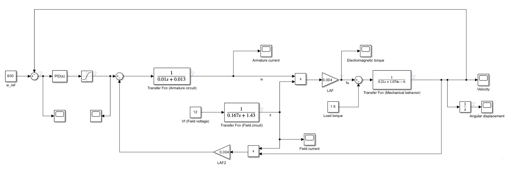
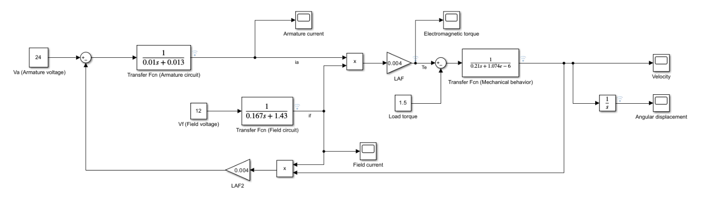
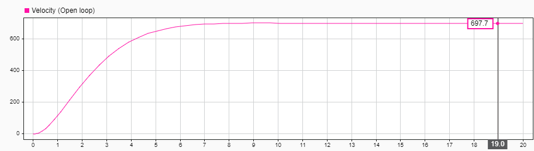
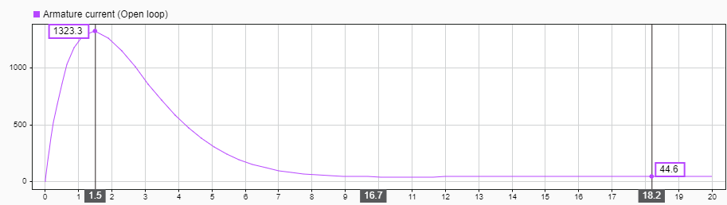
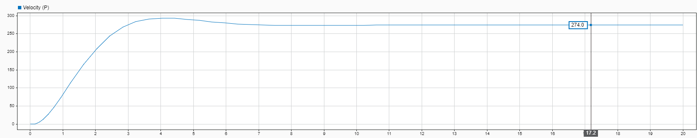
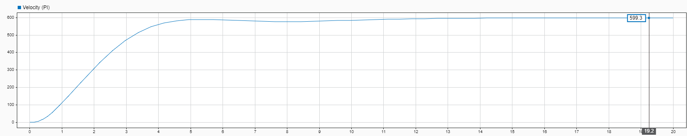
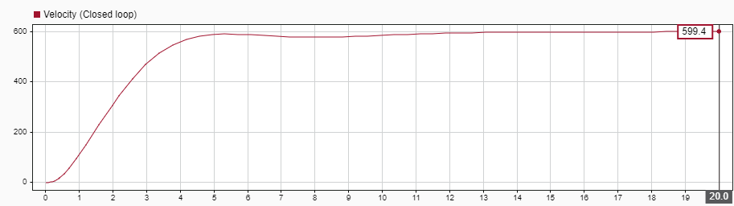
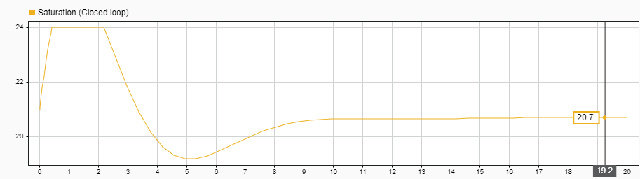
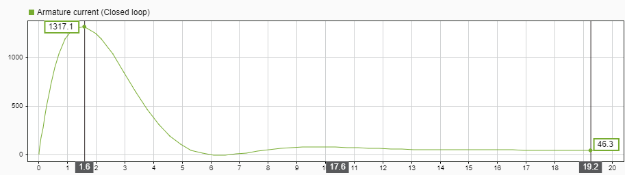
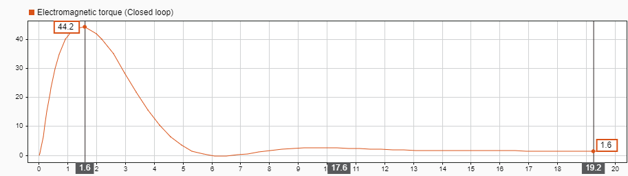

# Modelling and Control of a Separately Excited DC Motor in MATLAB/Simulink

A separately excited DC motor driving a constant-torque load is modelled from its field, armature and mechanical equations, simulated in Simulink, validated against the analytical steady state, and regulated to a reference speed with a PI controller whose output, the armature voltage, is limited to 0–24 V.

**Course:** Fundamentals of Electrical Engineering II, Sharif University of Technology, Spring 2026<br>
**Instructor:** Soheil Vafaei<br>
**Authors:** Amirmahdi Niazi, Alireza Amjadi, Ali Sakhaei

**Report:** [English (PDF)](report/report-en.pdf) · [Persian, original (PDF)](report/report-fa.pdf)

<p align="center">
  
  <br><em>Closed-loop Simulink model: reference speed, PI controller, saturation (0–24 V), motor.</em>
</p>

## Contents

1. [Problem statement](#1-problem-statement)
2. [Choice of load and motor configuration](#2-choice-of-load-and-motor-configuration)
3. [Mathematical model](#3-mathematical-model)
4. [Open-loop simulation and validation](#4-open-loop-simulation-and-validation)
5. [Speed-controller design](#5-speed-controller-design)
6. [Closed-loop results](#6-closed-loop-results)
7. [Conclusion](#7-conclusion)
8. [Simulink models](#8-simulink-models)

## 1. Problem statement

| Item | Choice |
|---|---|
| Load type | constant torque |
| Load value | T_L = 1.5 N·m |
| Motor type | separately excited DC motor |
| Speed-control target | ω_ref = 600 rad/s |

In open loop the armature voltage is constant and the motor reaches a natural speed set by its parameters and the load. In closed loop a controller regulates the speed at 600 rad/s.

## 2. Choice of load and motor configuration

A constant-torque load is simpler to model than a constant-power load, whose torque varies inversely with speed, and 1.5 N·m is large enough to show the transient behaviour of current, torque and speed.

| Motor configuration | Main feature | Suitability for the 1.5 N·m load |
|---|---|---|
| Series | high starting torque; field and armature in series | speed control more difficult; too powerful for this load |
| Shunt | approximately constant speed; field and armature in parallel | acceptable, but less control flexibility |
| Permanent magnet | simple; no field winding | field flux cannot be controlled |
| **Separately excited** | independent field and armature supplies | **best choice for this project** |

With independent supplies, the field voltage is kept constant (V_f = 12 V), so the flux is approximately constant and the torque depends mainly on the armature current; the speed is controlled through the armature voltage, 0 ≤ V_a ≤ 24 V.

## 3. Mathematical model

| Parameter | r_a | L_AA | V_a | V_f | T_L | J | B_m | r_f | L_FF | L_AF |
|---|---|---|---|---|---|---|---|---|---|---|
| Value | 0.013 | 0.01 | 24 | 12 | 1.5 | 0.21 | 1.074 × 10⁻⁶ | 1.43 | 0.167 | 0.004 |

**Field circuit**

```math
V_f = r_f\, i_f + L_{FF}\frac{di_f}{dt}, \qquad \frac{I_f(s)}{V_f(s)} = \frac{1}{0.167\,s + 1.43}, \qquad i_{f,ss} = \frac{12}{1.43} = 8.39\ \mathrm{A}.
```

**Armature circuit**

```math
V_a = r_a\, i_a + L_{AA}\frac{di_a}{dt} + e_b, \qquad e_b = \omega L_{AF}\, i_f, \qquad I_a(s) = \frac{V_a(s) - e_b(s)}{0.01\,s + 0.013}.
```

**Torque and mechanical equation**

```math
T_e = L_{AF}\, i_f\, i_a = K i_a, \quad K = L_{AF}\, i_f \approx 0.03356, \qquad J\frac{d\omega}{dt} = T_e - B_m\omega - T_L .
```

**Torque–speed characteristic.** In the steady state,

```math
T_e = \frac{K}{r_a}\left(V_a - K\omega\right),
```

a nearly linear curve. At V_a = 24 V the stall torque is about 61.96 N·m and the no-load speed about 715.0 rad/s; at T_L = 1.5 N·m the analytical steady-state speed is about 697.7 rad/s.

<p align="center">
  
  <br><em>Open-loop model: V_a = 24 V, V_f = 12 V, T_L = 1.5 N·m, with the back-EMF fed back from the speed.</em>
</p>

## 4. Open-loop simulation and validation

Conditions: V_a = 24 V, V_f = 12 V, T_L = 1.5 N·m, simulation time 20 s.

<p align="center">
  
  
  <br><em>Open-loop speed (left) and armature current (right).</em>
</p>

The speed rises from zero to ω_ss ≈ 697.7 rad/s (6663 rpm). The field current settles at about 8.4 A (calculated: 8.39 A). The armature current is large at start-up, when there is no back EMF, and falls as the speed rises; the steady-state torque equals the load torque, since B_m is very small.

**Validation.** Solving the steady-state relations

```math
K\,\frac{V_a - K\omega}{r_a} = T_L + B_m\,\omega
```

gives ω_ss,theory ≈ 697.7 rad/s, identical to the simulated value, so the open-loop model is mathematically valid.

## 5. Speed-controller design

The reference ω_ref = 600 rad/s is below the open-loop speed of 697.7 rad/s, so it can be reached with less than 24 V; a higher reference would saturate the controller.

| Controller | Gains | Steady-state speed | Steady-state error |
|---|---|---|---|
| P | K_p = 0.03 | ≈ 274 rad/s | 326 rad/s |
| PI | K_p = 0.035, K_i = 0.015 | ≈ 599.4 rad/s | ≈ 0 |

<p align="center">
  
  <br><em>Speed response with the P controller.</em>
</p>

<p align="center">
  
  <br><em>Speed response with the PI controller.</em>
</p>

The P controller alone leaves a large steady-state error; adding the integral term removes it. No derivative term was used, because the PI response was acceptable and a derivative term could increase the sensitivity to noise.

## 6. Closed-loop results

Conditions: ω_ref = 600 rad/s, K_p = 0.035, K_i = 0.015, 0 ≤ V_a ≤ 24 V, simulation time 20 s.

<p align="center">
  
  
  <br><em>Closed-loop speed (left) and armature voltage (right).</em>
</p>

<p align="center">
  
  
  <br><em>Closed-loop armature current (left) and electromagnetic torque (right).</em>
</p>

| Quantity | Simulation | Check |
|---|---|---|
| Speed | ≈ 599.4 rad/s | reference 600 rad/s |
| Armature voltage | ≈ 20.7 V | V_a = r_a i_a + Kω = 0.013(44.7) + 0.03356(600) = 20.72 V |
| Armature current | ≈ 46.3 A | T_L/K ≈ 44.7 A |
| Electromagnetic torque | ≈ 1.6 N·m | ≈ T_L |
| Field current | ≈ 8.39 A | V_f/r_f |

The speed reaches the reference with a small, acceptable overshoot and almost no steady-state error. At start-up the controller drives the armature voltage to the 24 V limit for a short time, then reduces it as the speed approaches the reference. The starting current is high; in a real system a current limiter, a soft starter or a current-control loop would be used.

## 7. Conclusion

- For a medium constant-torque load of 1.5 N·m, the separately excited DC motor with independent field and armature supplies is the most suitable configuration: the field current stays at about 8.39 A, the flux is approximately constant and the torque is controlled through the armature current.
- The open-loop simulation gives a steady-state speed of 697.7 rad/s, equal to the analytical value, which validates the model.
- A P controller is not sufficient; the PI controller brings the speed to 599.4 rad/s, practically equal to the 600 rad/s reference, with an armature voltage of about 20.7 V, in agreement with the theoretical value.

## 8. Simulink models

| File | Content |
|---|---|
| [`simulink/dc_motor_open_loop.slx`](simulink/dc_motor_open_loop.slx) | open-loop model (V_a = 24 V, V_f = 12 V, T_L = 1.5 N·m) |
| [`simulink/dc_motor_pi_control.slx`](simulink/dc_motor_pi_control.slx) | closed-loop model with PI controller and saturation |

Open a model in MATLAB/Simulink and run it (simulation time 20 s).

## License

Models: [MIT](LICENSE). Reports and figures: [CC BY 4.0](https://creativecommons.org/licenses/by/4.0/).
